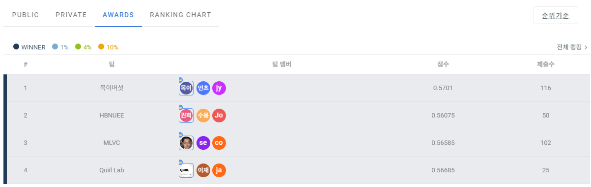
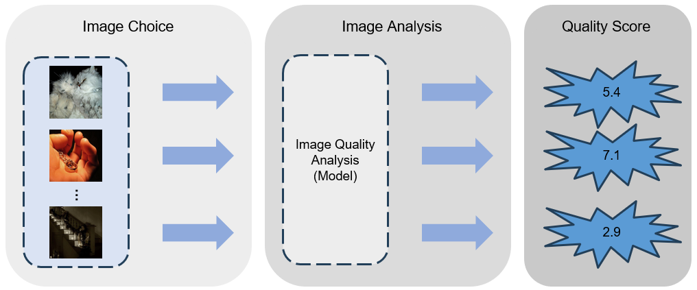
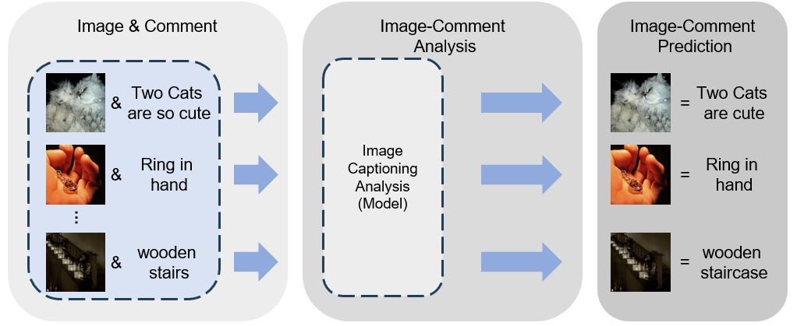

<div align="center">

# 2023 Samsung AI Challenge: Image Quality Assessment

**Final Winner (3rd place) · Team Quiil Lab**

[](https://dacon.io/competitions/official/236134/overview/description)
[](https://dacon.io/competitions/official/236134/leaderboard)
[](https://dacon.io/competitions/official/236134/talkboard/409957)
[](https://dacon.io/forum/410484)
[](https://dacon.io/competitions/official/236134/data)

</div>

Our solution predicts a mean opinion score (MOS, Task 1) and writes a short critique-style caption (Task 2) for every test image. The two models are combined into a single submission file. It placed **3rd on the final leaderboard** and was selected as a **Final Winner**.



## Approach

- **Task 1: image quality assessment.** We start from [MANIQA](https://github.com/IIGROUP/MANIQA) and swap its backbone for a hybrid ViT-R50 (`vit_base_r50_s16_384`, 384×384 input). Patch tokens from ViT blocks 7–10 pass through three transposed-attention and Swin stages. A patch-weighted head regresses the MOS.
- **Ordinal auxiliary head.** The CLS token feeds a scalar head trained with a cross-entropy ordinal (CEO) loss over 21 MOS bins, which is added to the MSE loss. We keep the checkpoint with the best SRCC + PLCC on the validation split.
- **Task 2: image captioning.** A [Meshed-Memory Transformer](https://github.com/aimagelab/meshed-memory-transformer) (code via [RSTNet](https://github.com/zhangxuying1004/RSTNet)) runs on 7×7 grid features from an X-152 detector ([grid-feats-vqa](https://github.com/facebookresearch/grid-feats-vqa)). It is trained first with cross-entropy and then with SCST (CIDEr reward). Decoding uses beam search (beam 3, max 23 tokens).

| Task 1: IQA | Task 2: captioning |
|---|---|
|  |  |

## Project structure

```
.
├── config.py              # all paths (data/, checkpoints/, outputs/) and hyperparameters
├── inference.py           # end-to-end: captions + MOS -> submission CSV
├── iqa/                   # Task 1 (MANIQA-based, Apache-2.0, see iqa/LICENSE)
│   ├── model.py           #   MANIQA + ViT-R50 backbone + ordinal head, CEO loss
│   ├── swin.py            #   Swin blocks vendored from MANIQA
│   ├── dataset.py         #   DACON image/MOS dataset and transforms
│   ├── train.py           #   training loop (python -m iqa.train)
│   └── predict.py         #   MOS inference
├── captioning/            # Task 2 (M2 Transformer via RSTNet, BSD-3, see captioning/LICENSE)
│   ├── models/            #   vendored M2 Transformer + beam search
│   ├── data/              #   vendored text/feature fields and COCO-style dataset
│   ├── evaluation/        #   vendored BLEU/METEOR/ROUGE/CIDEr + PTB tokenizer (needs Java)
│   ├── prepare_data.py    #   COCO-style JSONs + X-152 grid features (HDF5)
│   ├── train.py           #   XE -> SCST training (python -m captioning.train)
│   ├── predict.py         #   model building, vocab loading, beam-search captioning
│   └── vocab.pkl          #   vocabulary used by the submitted model (7,288 tokens)
├── tests/test_smoke.py    # end-to-end smoke test on random data
├── assets/                # README figures
├── requirements.txt
└── Dockerfile
```

## Environment

```bash
git clone https://github.com/JcLee96/2023-Samsung-AI-Challenge-IQA.git
cd 2023-Samsung-AI-Challenge-IQA

conda create -n samsung2023 python=3.8 && conda activate samsung2023
pip install -r requirements.txt
python -m spacy download en_core_web_sm          # tokenizer for captioning training
# only for grid-feature extraction:
pip install fvcore==0.1.5.post20221221 'git+https://github.com/facebookresearch/detectron2.git@ffff8ac'
```

Captioning training also needs Java, because the PTB tokenizer and METEOR use `.jar` files.

**Docker.** You can build the image from `Dockerfile` (`docker build -t quiil_samsung2023_solution .`). You can also load the image we used during the competition ([download](https://drive.google.com/file/d/1DD8DMOIm-SiVcuparVPb5Hy_3QD3dKPW/view?usp=drive_link)):

```bash
docker load < quiil_samsung2023_solution.tar
docker run -d --shm-size 8G --gpus all -it --name samsung_quiil \
  --mount type=bind,source=<absolute path of data>,target=/samsung2023_iqa_solution/data \
  quiil_samsung2023_solution
```

## Dataset

Download the competition data from [DACON](https://dacon.io/competitions/official/236134/data). The data is not redistributed here. Put it under `data/`, or point `SAMSUNG_DATA_DIR` to another location:

```
data/
├── train/*.jpg
├── test/*.jpg
├── train.csv        # img_name, img_path, mos, comments
├── test.csv         # img_name, img_path
├── train_mos.csv    # img_path, mos  (IQA training split)
└── valid_mos.csv    # img_path, mos  (IQA validation split)
```

`train_mos.csv` / `valid_mos.csv` hold our train/validation split of `train.csv`, using columns `img_path, mos`.

## Usage

**1. Prepare captioning inputs.** This step writes `data/{train,valid,test}.json` and the grid features `data/{train,test}.hdf5`. First clone [grid-feats-vqa](https://github.com/facebookresearch/grid-feats-vqa) into `./grid-feats-vqa` and put the X-152 checkpoint there as `X-152.pth`. Then run:

```bash
python -m captioning.prepare_data
```

**2. Train Task 1 (IQA).** The best checkpoints go to `checkpoints/iqa/epoch{N}.pt`.

```bash
python -m iqa.train
```

**3. Train Task 2 (captioning).** The checkpoints go to `checkpoints/captioning/` (`m2_best.pth`, `rl{N}.pth`).

```bash
python -m captioning.train
```

**4. End-to-end inference.** Copy the chosen weights to `checkpoints/epoch_iqa.pt` and `checkpoints/epoch_ic.pt`, or pass `--iqa-ckpt` / `--ic-ckpt`. Then run:

```bash
python inference.py            # -> outputs/submission.csv  (img_name,mos,comments)
```

Captions are cached in `outputs/predicted_captions.json`. Delete that file to recompute them.

First rows of our final submission:

```
img_name,mos,comments
j00zs3u6dr,6.3342686,i love the colors and the clarity of this image
ytv70so3zb,6.0468326,i m not sure what this is but i think it would have been better with a little more contrast
ia9890oozp,6.021466,i like the use of selective desaturation in this photo
xsj81ypx4a,5.4849973,i think this would have worked better in bw with a little more contrast
```

## Smoke test

This builds a tiny random dataset with numpy. It trains and runs the IQA model for one epoch (random init, smaller hybrid ViT by default), runs one captioning training step plus greedy and beam decoding on random 49×2048 grid features, and writes and checks a submission CSV. No downloads or checkpoints are needed.

```bash
python tests/test_smoke.py                       # CPU, about 1-2 min
SMOKE_DEVICE=cuda SMOKE_FULL_BACKBONE=1 python tests/test_smoke.py   # real ViT-R50 backbone on GPU
```

## Acknowledgements

- [MANIQA](https://github.com/IIGROUP/MANIQA) (Apache-2.0): IQA architecture and Swin blocks.
- [Meshed-Memory Transformer](https://github.com/aimagelab/meshed-memory-transformer) and [RSTNet](https://github.com/zhangxuying1004/RSTNet) (BSD-3-Clause): captioning model, data pipeline and evaluation code.
- [grid-feats-vqa](https://github.com/facebookresearch/grid-feats-vqa) and [detectron2](https://github.com/facebookresearch/detectron2): X-152 grid features.
- [timm](https://github.com/huggingface/pytorch-image-models): ViT-R50 backbone.

## License
Project code is released under the [MIT License](LICENSE). Vendored code keeps its original license: `iqa/` (MANIQA, Apache-2.0) and `captioning/` (RSTNet / M2 Transformer, BSD-3-Clause).
